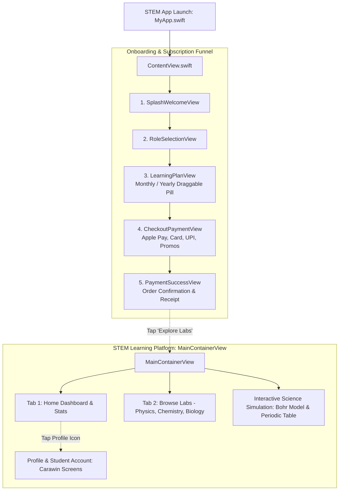

# STEM — Unified iOS Native App (Swift & SwiftUI)

**STEM** is a high-fidelity, native iOS application built with **Swift & SwiftUI** for interactive science and chemistry education (Classes 6–12 PCM). 

This repository brings together the complete **onboarding & subscription journey** with the team's comprehensive **interactive virtual lab platform, 3D simulations, and student dashboard**.

---

## 📱 How to Run in Xcode

1. Open the project in Xcode:
   ```bash
   open STEM.xcodeproj
   ```
2. Select the **STEM** scheme and any iOS Simulator (e.g., *iPhone 16 Pro*, *iPhone 15*).
3. Press **⌘ + R** (or click the **Play** button) to build and run.

---

## 🏗️ Unified Application Architecture

The entire app is structured into a unified experience orchestrated by [`ContentView.swift`](file:///Users/ratnamsmac/Documents/Projects/LabLearn/STEM/ContentView.swift):



---

## 📂 Project Directory Structure

```
STEM.xcodeproj/              # Unified Xcode project
STEM/
├── MyApp.swift              # App entry point (@main)
├── ContentView.swift        # Root flow coordinator (Onboarding ➔ Dashboard)
│
├── Views/
│   ├── Onboarding/          # User's Onboarding & Payment Work
│   │   ├── SplashWelcomeView.swift       # Full-bleed splash hero artwork & sign-in options
│   │   ├── RoleSelectionView.swift       # School-linked vs. Independent learner personas
│   │   ├── LearningPlanView.swift        # Draggable glass monthly/yearly toggle & plan tiers
│   │   ├── CheckoutPaymentView.swift     # Payment method selection & order summary
│   │   └── PaymentSuccessView.swift      # Transaction confirmation & receipt
│   │
│   ├── MainContainerView.swift          # Main tabbed host container
│   │
│   ├── Home/                            # Team's Dashboard Work
│   │   ├── HomeView.swift
│   │   ├── ContinueLearningCardView.swift
│   │   └── RecentLabRowView.swift
│   │
│   ├── BrowseLabs/                      # Team's Lab Catalog Work
│   │   ├── BrowseLabsView.swift
│   │   └── LabCardView.swift
│   │
│   └── Simulation/                      # Team's Interactive Simulation Work
│       ├── SimulationView.swift
│       ├── SimulationDetailFullScreenView.swift
│       ├── BohrModelView.swift
│       ├── PeriodicTableGridView.swift
│       └── ElementDetailSheetView.swift
│
├── CarawinAssignedScreens.swift         # Team's Profile, Badges & Stats
│
├── Components/              # Shared Reusable Design Components
│   ├── WaveHeader.swift                 # Organic double-crest Bézier wave header with crimson ring
│   ├── DashboardWaveHeader.swift        # Asymmetric deep-to-high wave header with integrated greeting & action cards
│   ├── CardContainer.swift              # Standardized elevated card wrapper
│   ├── CustomTabBar.swift               # Bottom navigation bar
│   ├── PillButton.swift                 # Rounded pill action buttons
│   ├── TogglePill.swift                 # Segmented pill controls
│   ├── SearchBarView.swift              # Search input field
│   ├── StatCard.swift                   # Metric statistics cards
│   ├── ElementCellView.swift            # Periodic table element cells
│   └── DecorativeArcView.swift          # Geometric decorative background accents
│
├── Models/                  # Shared Data Models
│   ├── PaymentModels.swift              # BillingCycle, SubscriptionPlan, PaymentMethod
│   ├── AppTab.swift                     # Navigation tabs (Home, Labs, Account)
│   ├── Lab.swift                        # Virtual lab metadata & progress
│   ├── Subject.swift                    # PCM subject categorizations
│   ├── Element.swift                    # Chemistry periodic table elements & electron shells
│   └── UserProfile.swift                # Student profile & stats
│
├── ViewModels/              # State & Business Logic
│   ├── HomeViewModel.swift
│   ├── BrowseLabsViewModel.swift
│   └── SimulationViewModel.swift
│
├── Services/                # Mock & Live Services
│   └── DataService.swift
│
├── Theme/                   # Unified Design System
│   └── Theme.swift                      # Oxford Blue, Crimson, Gold, gradients & typography
│
└── Assets.xcassets/         # App Colors & Images
    ├── AccentColor.colorset
    └── splash_bg.imageset               # Full-bleed splash screen background artwork
```

---

## 🎨 Unified Design System Highlights

1. **Mathematically Fitted Wave Header (`WaveHeader.swift`)**:
   - High-precision dual-crest Bézier curve with an integrated crimson ring arc at the top-right corner.
   - Clean back button integration and title typography.
2. **Interactive Draggable Plan Switcher (`LearningPlanView.swift`)**:
   - Fluid drag gesture with velocity snap-to-target.
   - Frosted glass capsule pill with subtle elevation shadow.
3. **Soft Ruby & Crimson Color Palette (`Theme.swift`)**:
   - Softened matte ruby gradient (`#BA1438` / `#8C0A29`) eliminating eye strain.
   - Contrast-accessible text tokens adhering to iOS human interface guidelines.
4. **Seamless Transition**:
   - From successful checkout, a single tap on **"Explore Labs"** transitions directly into the full multi-tab STEM student platform.
